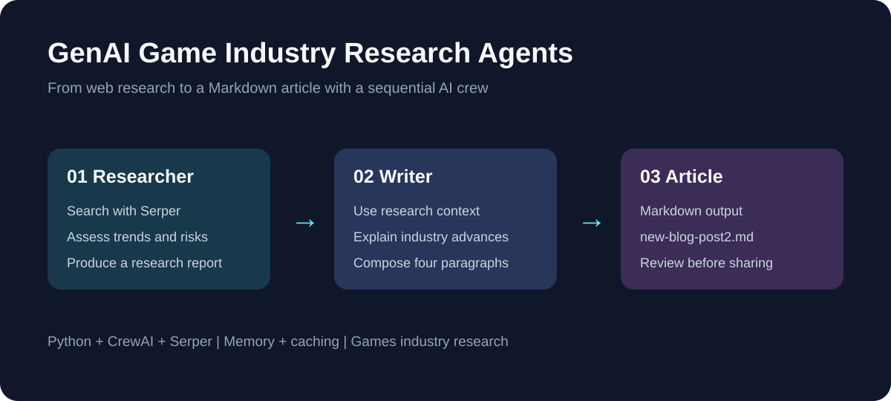

# GenAI Game Industry Research Agents



A Python experiment that coordinates a **Senior Researcher** and a **Writer** with CrewAI. The crew searches the web through Serper, investigates technology trends in the games industry, and turns its findings into a Markdown article.

## Project summary

This repository demonstrates role-based agents, tool use, sequential tasks, memory, and caching in one readable script. It is a learning prototype rather than a deployed application. The project image above is an architecture illustration, not a screenshot of a user interface.

## How the workflow works

1. The researcher searches for games-industry trends and evaluates benefits, market opportunities, and risks.
2. The research task requests a three-paragraph report.
3. The writer runs after the researcher in a sequential crew and writes an accessible four-paragraph article.
4. CrewAI saves the article to `new-blog-post2.md`, and the script prints the final result.

| Component | Configuration in the script |
| --- | --- |
| Senior Researcher | Web search, verbose logging, memory, delegation enabled |
| Writer | Web search, verbose logging, memory, delegation disabled |
| Search tool | `SerperDevTool` |
| Execution | `Process.sequential` |
| Crew settings | Memory and caching enabled; `max_rpm=100` |
| Output | Markdown file plus terminal output |

## Repository contents

```text
app.py                       Agent definitions, tasks, crew, and execution
requirements.txt             Python dependencies (unpinned)
.env.example                 Placeholder environment variable names
.gitignore                   Excludes secrets, caches, and generated output
new-blog-post.md              Historical sample output from a different topic
README.md                    Project documentation
docs/project-overview.svg    Project architecture image
```

The historical `new-blog-post.md` discusses a different industry and contains unverified claims. It is retained as an existing artifact and is not representative of the current games-industry prompts or a validated research result.

## Setup

Use a Python version supported by your installed CrewAI release. See the [official CrewAI installation guide](https://docs.crewai.com/en/installation) for current requirements.

```powershell
git clone https://github.com/vams2krish/GenAI-Game-Industry-Research-Agents.git
cd GenAI-Game-Industry-Research-Agents
python -m venv .venv
.\.venv\Scripts\Activate.ps1
python -m pip install -r requirements.txt
```

On macOS/Linux, activate the environment with `source .venv/bin/activate`.

### Credentials

The script reads two environment variables. Set them in the terminal where you run the project:

```powershell
$env:OPENAI_API_KEY = "YOUR_OPENAI_API_KEY"
$env:SERPER_API_KEY = "YOUR_SERPER_API_KEY"
python app.py
```

For macOS/Linux:

```bash
export OPENAI_API_KEY="YOUR_OPENAI_API_KEY"
export SERPER_API_KEY="YOUR_SERPER_API_KEY"
python app.py
```

`.env.example` is a reference only: the script does not automatically load `.env` files. Never put real credentials in source control. Missing credentials cause a clear error before the crew is constructed. Obtain credentials from [OpenAI Platform](https://platform.openai.com/) and [Serper](https://serper.dev/). Running the crew makes external API calls and may incur charges.

## Customizing the crew

Edit the agent `role`, `goal`, and `backstory` fields to change responsibilities. Adjust each task's `description` and `expected_output` to control the research scope and article structure. Change `output_file` to choose a different destination.

The `topic` passed to `crew.kickoff()` is currently not referenced through a `{topic}` placeholder in the task descriptions. Changing that input alone will not retarget the hardcoded games-industry prompts; edit the prompts as well. The research task's expected output mentions AI trends, while its description covers games-industry trends more broadly.

## Limitations and validation

- This is an older CrewAI example. Dependencies are unpinned, and compatibility with current releases has not been established. Settings such as `share_crew=True` may require review against the installed version.
- No model is explicitly selected in the script; model behavior and access depend on CrewAI configuration and provider defaults.
- Memory may require additional provider configuration and local storage, depending on the installed release.
- Search results and generated claims need human verification. The script does not enforce citations or fact-check its output.
- Verbose logs can contain prompts, research, and generated text. Review the configured sharing and logging behavior before processing private information.
- Publication checks cover Python syntax, repository contents, and credential removal. A live paid API run has not been performed.

## Suggested next steps

Pin and test compatible dependency versions, parameterize the topic in all prompts, add explicit source citations, and make model selection configurable. A CLI and repeatable integration tests would make the prototype easier to maintain.

## References

- [CrewAI source and documentation](https://github.com/crewAIInc/crewAI)
- [CrewAI installation](https://docs.crewai.com/en/installation)
- [Serper](https://serper.dev/)

## License

No license has been selected for this project. Add an appropriate license before granting reuse rights beyond those provided by GitHub's terms.
